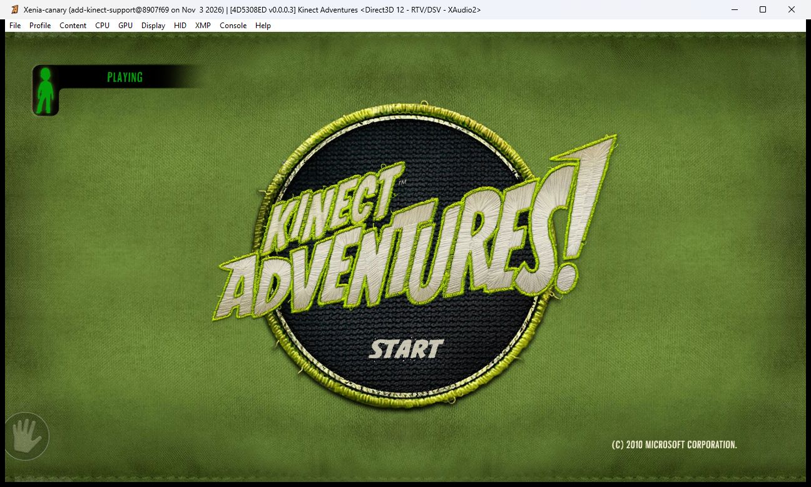
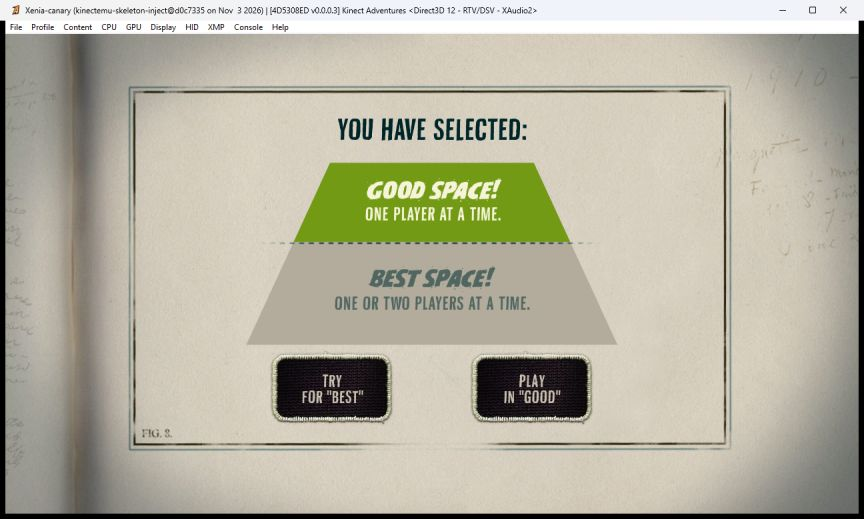
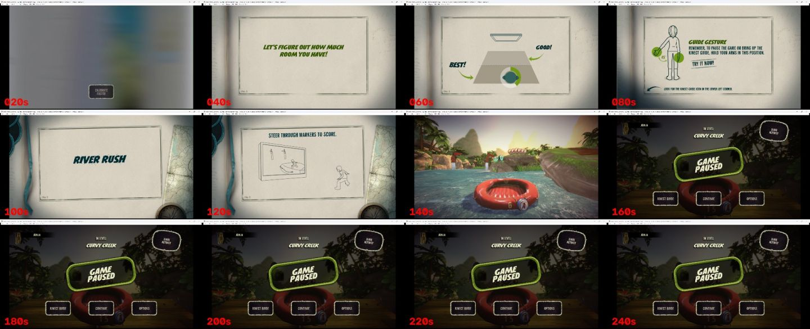

# KinectEmu

Play Xbox 360 Kinect games in the [Xenia Canary](https://github.com/xenia-canary/xenia-canary) emulator on a normal Windows laptop, using its built-in webcam instead of a Kinect sensor.

Kinect titles track the player with the sensor's depth image and a skeleton solver linked into the game. A webcam gives colour only. KinectEmu runs a pose model on the webcam frames, builds a synthetic Kinect depth image and a 20-joint skeleton from the result, and feeds both into a small fork of Xenia. The game then sees a Kinect with a player in front of it.

**This is an early research prototype (Phase 0, feasibility, started 2026-11-02).** It has been tested on one laptop and one game. It is not a finished product and it is not yet known to be playable. See [Status](#status).

## Status

Tested on exactly one machine: HP Victus 15 (i7-12650H, RTX 4050 + Intel UHD, HP Wide Vision HD webcam), Windows 11. The only title tried is **Kinect Adventures** (title ID `4D5308ED`), from an image of the author's own disc.

| Works (checked on that laptop) | Does not work, or known limits | Not tested yet |
|---|---|---|
| Kinect Adventures boots, sees the emulated sensor and passes its Kinect setup (calibration, play-space screen) | The game's own depth tracker, fed our synthetic depth, lost the player often. That path (`--nui=pipe` alone) was judged not playable by the author | Steering and jumping in River Rush on the injected skeleton, by a human, live |
| With skeleton injection, the webcam skeleton alone drives the game through setup and its guide-gesture tutorial, and starts River Rush | GPU contention: under Optimus the iGPU also composites Xenia's output, and our pose work shares the machine with the emulator. During gameplay the feed fell to 12-22 fps in one test | End-to-end latency with injection on |
| Mirroring is correct (hand cursor follows the hand, correlation +0.90 in the harness) | Display-to-camera latency alone is about 186 ms (p50, measured). Real Kinect end-to-end is roughly 100 ms | Any title other than Kinect Adventures (Dance Central, Joy Ride, Kinect Sports need their XEX inspected first) |
| The automated hands-free harness passes: scripted figure for 300-480 s, hand-cursor case, and a recorded webcam clip | The webcam sees a wider field of view (77.6 x 48.9 degrees) than a Kinect (57 x 43), so players must stand further back | Two players. A phantom second player seen in one live run was a tracker bug, since fixed; two real players were never tested |
| Camera at 30 fps in normal room light; pose pipeline p50 about 15 ms, p95 about 21 ms for two people | 30 fps needs light on the player. In an evening-light test the camera dropped to about 24 fps | Other machines, other webcams, single-GPU laptops |
| Live feed 25-30 fps into Xenia at one player | | Gameplay for 10 minutes or more; a full session without a crash |

**Do not expect it to feel good yet.** A live "does it feel playable" check, with recording on, is the next planned step (see [Roadmap](#roadmap)). Sources: [docs/STATUS.md](docs/STATUS.md) and [docs/NUI_IMPLEMENTATION.md](docs/NUI_IMPLEMENTATION.md) hold every number above with the run that produced it.

| | | |
|---|---|---|
|  |  |  |
| Title screen, player marked PLAYING, from webcam depth on a recorded clip | Play-space setup passed on an injected test skeleton | First live run on the webcam skeleton, one frame every 20 s |

## How it works

```
 webcam (1280x720, 30 fps)
    |
    v
 pose:   MediaPipe pose landmarks (ONNX, DirectML GPU)  +  RTMO person detector (async, other GPU)
    |       3D world landmarks + 2D landmarks + one mask per player
    v
 placement:  PnP of world landmarks against 2D landmarks, calibrated intrinsics
    |        -> each player's position in metres; distance filtered and clamped
    v
 synth_depth.py
    |-- synthetic Kinect depth (640x480, mm): body silhouette, floor plane, back wall
    '-- 20-joint NUI skeleton (metres, sensor space) + floor plane
    |                                 |
    v                                 v
 pipe  \\.\pipe\kinectemu        pipe  \\.\pipe\kinectemu-skel
 (.xdepth frames)                (376-byte XNUISKL1 records)
    |                                 |
    v                                 v
 Xenia fork  --nui=pipe          --nui_skeleton_inject=pipe:kinectemu-skel
    |   depth reaches the title as if it came from a Kinect (PsCamDeviceRequest)
    |   the skeleton replaces the tracker's output at the title runtime's frame callback
    v
 the title's NUI runtime  ->  game
```

- Depth keeps flowing because the title's runtime makes one skeleton frame per depth frame. Injection rewrites that frame before the game, the HUD or the logs see it. Details and evidence: [docs/NUI_IMPLEMENTATION.md](docs/NUI_IMPLEMENTATION.md).
- Xenia finds the injection site by code signature, not by fixed address.
- Everything stays on the machine. Pipes are local only. There is no network access at runtime.

## Requirements

**Hardware**
- A Windows laptop or PC with a webcam that holds 30 fps in your room. Full-body framing: stand about 2.2 m back.
- A DirectX 12 GPU for ONNX Runtime DirectML. Tested with an RTX 4050 plus an Intel UHD iGPU: the default settings put the landmark model on adapter 0 and the person detector on adapter 1, because two threads on one adapter crashed in testing. A machine with one GPU is untested; the `--device` and `--detector-device` flags exist for that.
- An image of **your own** Kinect Adventures disc. No game files are provided or linked, and dumping is up to you.

**Software**
- Windows 11 x64 (the only version tested).
- Python 3.11. Other versions are not supported.
- Git, and PowerShell (the scripts run in Windows PowerShell 5.1 and PowerShell 7).
- To build the Xenia fork: Visual Studio 2022 with the C++ desktop workload, LLVM (clang-format), Vulkan SDK at `C:\VulkanSDK`. About 15 minutes for a full build. See [docs/BUILDING.md](docs/BUILDING.md).

## Quick start

```powershell
git clone https://github.com/KevinPratap/kinectemu.git
cd kinectemu

# 1. Python environment, packages, and models (downloads and checks hashes)
.\scripts\setup.ps1

# 2. Build the Xenia fork (once, about 15 min). Follow docs\BUILDING.md.

# 3. Play: starts Xenia, then the webcam pipeline
.\scripts\run_live.ps1 -Iso "D:\path\to\Kinect Adventures!.iso"
```

Then stand about 2.2 m back with your whole body in view. Press `q` in the depth window to stop.

Notes:
- `.\scripts\setup.ps1 -DryRun` prints what it would do and runs nothing. `-SkipModels` skips the download.
- The MediaPipe landmark model is converted from TFLite to ONNX once, in a separate venv, because it needs TensorFlow. If `fetch_models.py` reports a missing `pose_landmarks_*.onnx`, it prints the exact `tf2onnx` command. Packages for that venv: [tools/requirements-convert.txt](tools/requirements-convert.txt).
- `run_live.ps1` defaults to `--camera 1`, which is the HP camera on the test laptop. On other machines try `-Camera 0` or the next index. The depth window shows what the pipeline sees.
- `docs/data/intrinsics.json` was calibrated for the test laptop's camera. Another camera needs its own calibration (`tools/phase0/calibrate_intrinsics.py`, steps in [docs/STATUS.md](docs/STATUS.md)). Without it, distances will be off.
- `.\scripts\run_live.ps1 ... -DryRun` prints the exact commands first.

## Hands-free testing

You do not have to stand up for every change. The harness runs the game in Xenia on a scripted figure (or recorded webcam frames), takes a screenshot every second, grades the game's logs and prints PASS/FAIL.

```powershell
.\scripts\run_harness.ps1 -Iso "D:\path\to\Kinect Adventures!.iso"                      # synthetic, 420 s
.\scripts\run_harness.ps1 -Case cursor -Iso "D:\path\to\Kinect Adventures!.iso"         # hand cursor, 170 s
.\scripts\run_harness.ps1 -Case frames:fixtures\live_20261104_120000 -Iso "..."          # replay recorded webcam frames
```

Checks: the hook bound, injection never fell back to the game's tracker, one tracking id, the injected body agrees with the game's own player mask (mirror check), steps and jumps reach the scripted values, no "GAME PAUSED" screen, hand cursor follows the hand. Output goes to `runs\harness_<case>_<time>` (git-ignored). The harness needs the same build and models as live play, but no camera. Details: [docs/NUI_IMPLEMENTATION.md](docs/NUI_IMPLEMENTATION.md) section 6.

## Tuning flags

These are `synth_depth.py` flags. Pass extra ones to `run_live.ps1` with `-ExtraSynthArgs "--no-mirror"`.

| Flag | Meaning |
|---|---|
| `--push-mm` | Move every player this far back (depth and silhouette scale). The webcam is wider than a Kinect, so a player framed for it stands too close. `run_live.ps1` default 700 |
| `--gain-x` | Exaggerate sideways position about the player's usual spot. The title passes on only part of a move. `run_live.ps1` default 1.4. A value of 2.0 carried normal steps out of the play area in testing |
| `--max-lateral-mm` | Cap on the amplified sideways offset from the player's usual spot (default 500) |
| `--camera` | Webcam index (default 1) |
| `--no-mirror` | Skip the horizontal flip of the webcam image. The default flip was checked against the game; `--no-mirror` made the hand cursor move the wrong way |
| `--record-frames DIR` | Live: also save every camera frame and its time to DIR, as a fixture the harness can replay. Opt-in. Keep it under `fixtures\` (git-ignored). Do not commit or share recordings |
| `--device` | DirectML adapter for the landmark model (default 0) |
| `--detector-device` | DirectML adapter for the async person detector (default 1; two threads on one adapter crash) |

Others worth knowing: `--gain-y` (exaggerate jumps), `--clamp-mm` (keep distance within lo,hi), `--hold-frames`, `--intrinsics`, `--trace`, `--no-window`. Run `tools\.venv\Scripts\python.exe tools\phase0\synth_depth.py --help` for all.

## Repository layout

```
README.md  CONTRIBUTING.md  LICENSE
scripts/        setup.ps1, run_live.ps1, run_harness.ps1
tools/
  requirements.txt  requirements-convert.txt  fetch_models.py
  phase0/       webcam probe, pose benchmarks, calibration, synth_depth.py (webcam -> depth + skeleton),
                scripted_skeleton.py, skeleton_harness.py, xdepth_writer.py, self-tests
xenia/          README.md and patches/ : the Xenia-side changes, as git patches
docs/           status, design notes, evidence (docs/data/*.json and screenshots)
.github/workflows/ci.yml
# git-ignored, created locally:
tools/.venv  models/  external/  fixtures/  runs/
```

## Documentation

| Document | What it is |
|---|---|
| [docs/STATUS.md](docs/STATUS.md) | What works, what was tried and failed, exact commands to reproduce each run |
| [docs/NUI_IMPLEMENTATION.md](docs/NUI_IMPLEMENTATION.md) | How skeleton injection works, the two-pipe live setup, the harness, next steps |
| [docs/BUILDING.md](docs/BUILDING.md) | Build the Xenia fork, tests, smoke test, all Xenia flags used here |
| [docs/WEBCAM_REPORT.md](docs/WEBCAM_REPORT.md) | Phase 0 webcam measurements: modes, fps, exposure, pose benchmarks, latency |
| [docs/PRIOR_ART.md](docs/PRIOR_ART.md) | Upstream Xenia Kinect work and other projects, read and tested |
| [docs/PSCAM_CONTRACT.md](docs/PSCAM_CONTRACT.md) | The `PsCamDeviceRequest` guest interface (Kinect v1 camera) and disparity math |
| [docs/NUI_LAYER.md](docs/NUI_LAYER.md) | Where frames enter a Kinect title; per-title XEX inspection state |
| [docs/MODELS.md](docs/MODELS.md) | Models used, sources, licences, SHA-256 |
| [xenia/README.md](xenia/README.md) | The Xenia-side patches and how to apply them |

## Roadmap

Phases come from the original brief; each starts only after the previous gate passes on the test laptop.

| Phase | Goal | State |
|---|---|---|
| 0 | Feasibility: webcam, pose speed, NUI layer, build toolchain | In progress. Webcam gate partial: two-player crossing test and latency budget still open |
| 1 | Game loading from images (physical disc boot is an optional parallel track) | Kinect Adventures boots from an image; other targets need images |
| 2 | Host sensor sources (webcam, replay, optional real Kinect) | Webcam and recorded-frame replay exist as scripts; no C++ source yet |
| 3 | Virtual Kinect: pose, metric placement, skeleton retarget, synthetic depth | Prototyped in Python |
| 4 | Guest-facing NUI: skeleton injection (Option B) and synthetic depth (Option A') | Both built and tested on one title |
| 5 | Skeleton fidelity and latency: per-title profiles, latency compensation | Not started |
| 6 | Per-title bring-up: Dance Central 1, Kinect Adventures (2 players), Joy Ride, Kinect Sports | Only Kinect Adventures started |

Next three steps ([docs/NUI_IMPLEMENTATION.md](docs/NUI_IMPLEMENTATION.md) section 7):
1. One live feel-check of River Rush about 2.2 m back, with `-Record`, judging steering, jumps and delay. The recording becomes a harness case.
2. Make the player mask agree with the injected body (put it in the tracker's dominant mask index, or emit depth for one player only).
3. Measure end-to-end latency with `latency_flash_test.py`; if the game's own smoothing dominates, consider a second hook on `NuiTransformSmooth`.

Non-goals: Kinect v2, Xbox One/Series, Xbox Live, ripping tools, training new models, network access at runtime.

## Contributing

See [CONTRIBUTING.md](CONTRIBUTING.md). Short version: every claim needs a log line, fixtures never get committed, run the harness before a PR.

## Licence

This repository's own code and documentation are under the [MIT licence](LICENSE).

The Xenia patches in [xenia/patches/](xenia/patches/) are derivative of Xenia and stay under Xenia's BSD-3-Clause licence.

Models are Apache-2.0 (see [docs/MODELS.md](docs/MODELS.md)). They are downloaded by you from their publishers, not redistributed here.

No game images, BIOS or copyrighted game files are distributed or linked. You must dump your own disc. Camera frames never leave your machine; recordings are opt-in and stored under the git-ignored `fixtures\`.

## Credits

- [Xenia Canary](https://github.com/xenia-canary/xenia-canary) and the Xenia project, for the emulator.
- [ryantimjohn/xenia-canary](https://github.com/ryantimjohn/xenia-canary), branch `add-kinect-support`, which this fork builds on (the guest depth path and `xe::nui::NuiSystem`).
- knuckleslee's upstream Kinect PR series for Xenia Canary, including the `PsCamDeviceRequest` contract in PR #1274.
- [BrinooTk/PS5X360](https://github.com/BrinooTk/PS5X360), the closest precedent for skeleton injection; its getter signature is used here to locate the runtime state.
- [MediaPipe](https://github.com/google-ai-edge/mediapipe) Pose Landmarker (Apache-2.0).
- [MMPose / RTMO](https://github.com/open-mmlab/mmpose) (Apache-2.0) and [rtmlib](https://github.com/Tau-J/rtmlib).
- Kinect, Xbox 360 and Kinect Adventures are trademarks of Microsoft. This project is not affiliated with or endorsed by Microsoft, Xenia or any of the projects above.
